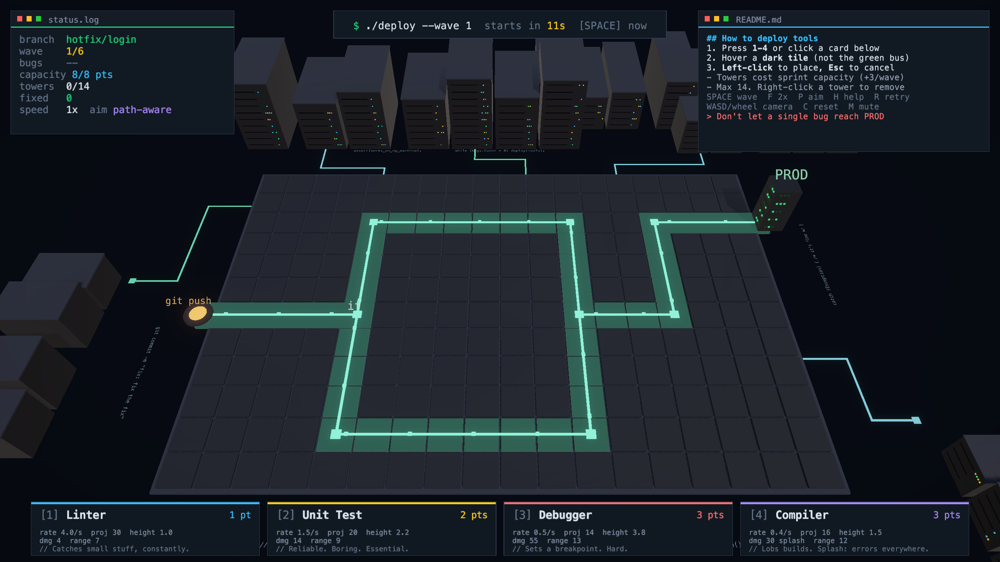
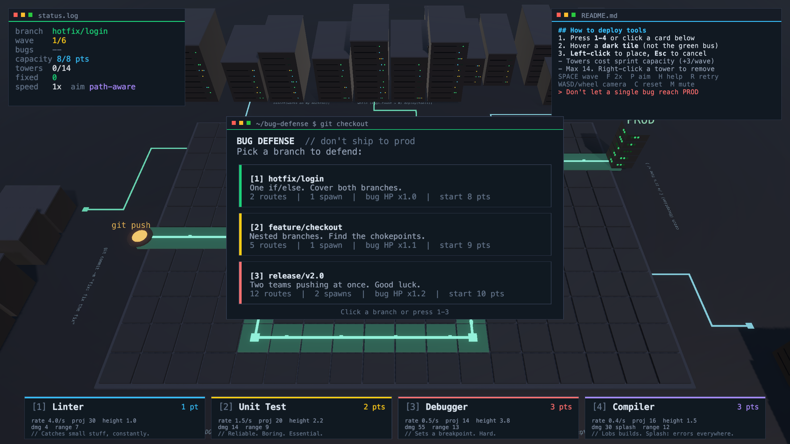
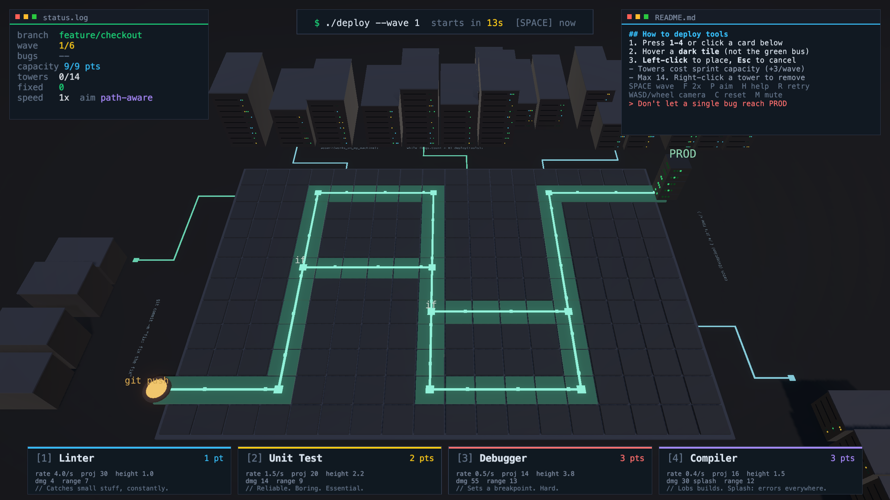
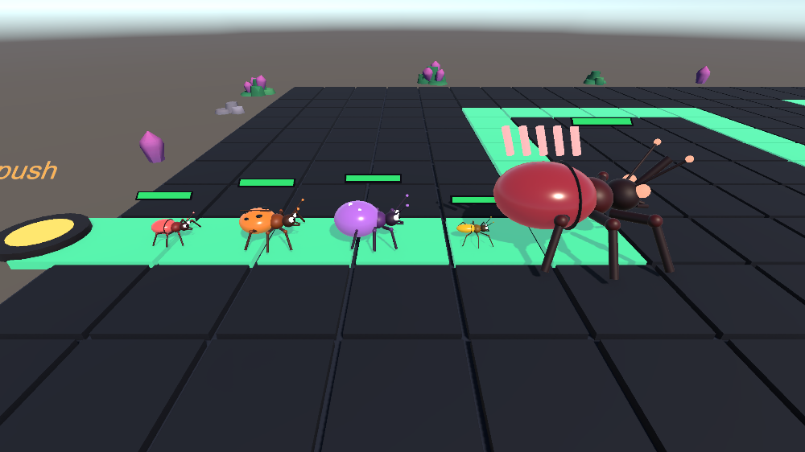

# Bug Defense: Don't Ship to Prod

A 3D tower defense game in Unity with a programming theme. You're the last engineer awake before a release. Bugs crawl through the codebase, along a branching circuit-board path, toward the **PROD** server rack. Deploy debugging tools (Linters, Unit Tests, Debuggers and Compilers) that fire physics projectiles and lead their targets. If a single bug reaches PROD, the pager goes off and you lose.



| Level select | Branching paths | Procedural, animated bugs |
|---|---|---|
|  |  |  |

---

## How to run

- **Unity version:** 6000.6.0f1 (Unity 6), Universal Render Pipeline, new Input System (`activeInputHandler = 1`).
- **Steps:**
  1. Open the project folder in Unity Hub.
  2. Open `Assets/Scenes/SampleScene.unity`. It's already in Build Settings.
  3. Press **Play**.
- **No scene setup is needed.** The whole game (map, camera, light, UI, managers) is built at runtime from code by `GameBootstrap`, so the scene can be empty. It works in any scene.
- **Fonts:** the UI uses a monospace OS font (Menlo, Consolas, ... with a built-in fallback).
- **Assets:** the 3D tower models are Kenney assets that ship with the repo.
- **Audio:** sound effects are synthesized in code.

## Controls

| Input | Action |
|---|---|
| `1` / `2` / `3` / `4` or click a card | Select Linter / Unit Test / Debugger / Compiler |
| Left-click a dark tile | Place the selected tower (the selection stays active) |
| `Esc` / right-click | Cancel the selection |
| Right-click a tower | Remove it (full refund in the build phase, 50% during a wave) |
| Hover a tower | Show its range ring and stats |
| `Space` | Start the next wave now |
| `F` | Toggle 2x speed |
| `P` | Toggle aim mode: path-aware (default) or linear |
| `WASD` / arrows, mouse wheel, `C` | Pan, zoom, reset camera |
| `H` | Hide / show the help panel |
| `M` | Mute |
| `R` | Restart the level |
| `N` / `L` (end screen) | Next level / level select |

## Grading requirements checklist

| Grade | Requirement | Implementation | How to see it in game |
|---|---|---|---|
| C | Player can place towers | `Towers/TowerPlacer.cs`: mouse raycast onto a `BuildTile`, with a ghost preview and placement validation | Press 1 and click a dark tile |
| C | Towers fire continuously at a set rate | `Towers/Tower.cs`: cooldown of `1 / fireRate` | Steady fire cadence whenever a bug is in range |
| C | Towers aim at an enemy | `Tower.AimAt`: head turns left/right, barrel tilts up/down | Turrets track bugs |
| C | Enemies travel predetermined paths | `Map/LevelDefinition.cs` (path graph), `Enemies/Enemy.cs` follows its route's waypoints | Bugs follow the glowing bus |
| C | Game ends when an enemy completes its path | `Enemy.ReachedEnd` calls `GameManager.GameOver` | "PRODUCTION IS DOWN" screen, PROD rack flashes red |
| B | 2+ tower types with different rate of fire, projectile speed and **height** | `Towers/TowerCatalog.cs` (4 types). `TowerModel` stretches each body so the fire point sits exactly at the type's height | Debugger is visibly tallest (3.8), Linter shortest (1.0) |
| B | Text overlay explaining how to place towers | `UI/HUD.cs`, "README.md" window (top right, always visible) | Top-right panel |
| B | Limited number of towers | `Core/GameManager.cs`: sprint capacity points + hard cap of 14 towers | Capacity / tower counters; red error message when out |
| B | Paths are not straight lines | `Map/LevelCatalog.cs`: zig-zag paths that **fork and merge** | Every level |
| A | Multiple enemy types with different speed and HP | `Enemies/EnemyCatalog.cs` (4 types + boss) | See the enemy table below |
| A | Non-basic assets | Kenney Tower Defense Kit models (`Visuals/ModelLibrary.cs`, `Towers/TowerModel.cs`), with a primitive fallback | Tower bodies and weapons |
| A | Aim at the **predicted** location from velocity and position | `Towers/AimPredictor.cs`: `PredictInterceptPoint` (linear) and `PredictAlongPath` (path-aware) | Slow Debugger shots hit fast Race Conditions. Press P to compare modes |
| A+ | Above and beyond | See "Above and beyond" below | |

## Towers

All towers use "first" targeting: they target the bug with the shortest remaining path distance to PROD, across all branches. Every shot is a physics projectile: a dynamic Rigidbody with continuous collision detection.

| Key | Tower | Cost | Fire rate | Projectile speed | Height | Damage | Range | Notes |
|---|---|---|---|---|---|---|---|---|
| 1 | Linter | 1 | 4.0/s | 30 | 1.0 | 4 | 7 | Cheap rapid fire |
| 2 | Unit Test | 2 | 1.5/s | 20 | 2.2 | 14 | 9 | All-rounder |
| 3 | Debugger | 3 | 0.5/s | 14 | 3.8 | 55 | 13 | Heavy, slow slug; taller = longer range |
| 4 | Compiler | 3 | 0.4/s | 16 (launch) | 1.5 | 30 splash (r 2.5) | 12 | Ballistic mortar with gravity, high arc |

## Enemies

| Bug | HP | Speed | Look | Special |
|---|---|---|---|---|
| Syntax Error | 20 | 4.5 | Red beetle | Fast, fragile |
| Logic Bug | 60 | 2.6 | Orange spotted ladybug | None |
| Memory Leak | 220 | 1.3 | Bloated purple blob with glowing bubbles | Grows 1.0x to 1.6x in size and gains HP over time |
| Race Condition | 12 | 7.5 | Thin yellow bug with a speed trail | Very fast, speed jitters ±15% |
| Production Outage (boss) | 1500 | 0.9 | Huge horned beetle, red eyes, error spikes | On death splits into 6 Syntax Errors that continue from its spot on the path |

**Bug models:** each bug is a procedural insect (`Enemies/BugModel.cs`) with a segmented body, eyes, antennae and six jointed legs. The legs walk in an alternating tripod gait (three legs at a time, like real insects), and the step rate follows the bug's speed so the feet don't slide.

## Levels and waves

The path of each level is a directed graph (`LevelDefinition`). Every spawn-to-PROD walk through the graph is a route. Each bug picks a random route when it spawns, so the path visibly forks ("if" markers) and merges.

| Level | Layout | Routes | Spawns | Start capacity | Bug HP |
|---|---|---|---|---|---|
| `hotfix/login` | One fork around a central block, then merge | 2 | 1 | 8 | x1.0 |
| `feature/checkout` | Long serpentine; each loop has a shortcut | 4 | 1 | 9 | x1.05 |
| `release/v2.0` | Two spawns merge into one core, which forks and re-merges | 4 | 2 | 10 | x1.1 |

**Six waves per level.** Each wave has an HP multiplier for regular bugs; the boss keeps its hand-tuned HP. Clearing a wave grants **+3 sprint capacity**.

| Wave | Name | Contents | HP |
|---|---|---|---|
| 1 | Typos | 12 Syntax Error | x1.0 |
| 2 | It compiles, but... | 10 Syntax Error, 7 Logic Bug | x1.1 |
| 3 | Works on my machine | 10 Logic Bug, 12 Race Condition | x1.25 |
| 4 | Heap of trouble | 4 Memory Leak, 18 Syntax Error, 8 Race Condition | x1.3 |
| 5 | Friday deploy | 12 Logic Bug, 12 Race Condition, 6 Memory Leak (interleaved) | x1.6 |
| 6 | PRODUCTION OUTAGE | Boss, 3 Memory Leak, 16 Race Condition, 10 Logic Bug | x1.6 |

**Build phase:**
- A 20 s countdown before wave 1 and 10 s between waves. `Space` skips it.
- A wave is cleared when every bug has spawned and none are left alive.

## Predictive aiming

**Linear prediction (the A requirement).** `AimPredictor.PredictInterceptPoint` solves for the time `t` at which a constant-speed projectile meets a target moving at constant velocity:

- The condition is `|D + V t| = s t`, where `D` = target − shooter, `V` = target velocity and `s` = projectile speed.
- This gives the quadratic `(V·V − s²) t² + 2 (D·V) t + D·D = 0`.
- The tower aims at `target + V t`, using the smallest positive root.
- `Enemy.Velocity` is direction × current speed.

**Limitation: corners.** Linear prediction assumes the bug keeps going straight, so it misses when a bug turns a corner mid-flight.

**Path-aware prediction (A+, default; press `P` to toggle).** `AimPredictor.PredictAlongPath` uses `Enemy.PredictPosition(t)`, which walks the bug along its remaining waypoints. It iterates: estimate the flight time to the predicted point, predict where the bug will be at that time, repeat. That way it follows corners and forks.

**Ballistic Compiler (A+).** The Compiler fires a gravity projectile at a fixed launch speed:

- The launch angle comes from `θ = atan((v² ± √(v⁴ − g(g x² + 2 y v²))) / (g x))`, using the high arc (falling back to the low arc if the high one can't reach).
- To lead the target, it guesses a flight time, predicts the bug's position at that time, re-solves the angle, and takes that arc's actual flight time as the new guess. Six iterations.
- **Test result:** in testing, four Compilers killed 1/8 bugs with linear prediction and 8/8 with path-aware prediction. A shell is airborne for about 3 s, so corners matter.

## Above and beyond

- **Levels:**
  - Three levels with branching, merging path graphs and a two-spawn final level.
  - Level select screen; next level / level select from the end screens.
- **Towers:**
  - Compiler mortar with ballistic, gravity-arc prediction and splash damage.
  - Path-aware predictive aiming with a live toggle.
- **Enemies:**
  - Boss that splits into 6 children, which continue along its route.
  - Memory Leak that grows and regenerates.
  - Race Condition with speed jitter.
  - Procedural insects with a six-leg walk animation and a distinct body plan per type.
- **Feedback:**
  - Hit sparks, damage flash, death bursts with floating "fixed!" text, and expanding splash rings.
  - Placement ghost (green/red), range rings, hover tooltips, and refunds on removal.
  - Sound effects synthesized at runtime (no audio files); `M` mutes.
- **Presentation:**
  - Data-packet animation streaming along the path, and "if" markers at forks.
  - Datacenter backdrop: server rack clusters with blinking LEDs, PCB traces, code printed on the floor, and fog.
  - Code-editor UI: window title bars, monospace font, terminal-style countdown, and incident/release logs on the end screens.
- **Controls:** 2x speed, early wave start, camera pan/zoom.

## Project structure

```
Assets/
  Scripts/
    Core/      GameBootstrap, GameManager, GameInput (input wrapper), GameState, CameraRig
    Map/       LevelDefinition, LevelCatalog, PathDefinition, GridMap, BuildTile, PathFlow,
               SpawnPortal, ProdServer, Scenery
    Enemies/   EnemyType, EnemyCatalog, Enemy, BugModel, EnemyRegistry, WaveDefinition, WaveSpawner, HealthBar
    Towers/    TowerType, TowerCatalog, Tower, TowerModel, Projectile, AimPredictor, TowerPlacer
    UI/        HUD, UIFactory
    Visuals/   MaterialFactory, ShapeFactory, ModelLibrary, HitFx, FloatingText, RangeRing, Blinker, WorldLabel
    Audio/     Sfx (procedural sound effects)
  Resources/Models/Kenney/   Kenney tower and weapon models (loaded at runtime)
  ThirdParty/KenneyTowerDefense/License.txt
```

**Technical notes:**
- **No editor setup:** no scene objects, prefabs, tags, layers or TextMeshPro are required. Materials pick URP or built-in shaders at runtime, so nothing renders pink.
- **Input:** all input goes through `GameInput`, which compiles under either the new Input System or the legacy Input Manager.
- **Static state:** reset on load, so restarts and disabled domain reload both work.

## Credits

- **3D models:** [Kenney Tower Defense Kit](https://kenney.nl/assets/tower-defense-kit) by Kenney (www.kenney.nl), CC0. The license is in `Assets/ThirdParty/KenneyTowerDefense/License.txt`.
- **Everything else** (bugs, environment, effects, UI, sound): procedural, built in code for this project.
- **AI assistance:** developed with AI assistance (Claude Code) driven by my own prompts and design direction, as permitted by the course policy ("work must be your own or the result of your own AI prompts").

---

**Course:** CSCI 381, Video Game Design and Development, Fall 2026, Assignment 2
**Author:** Daniel Fernandez
